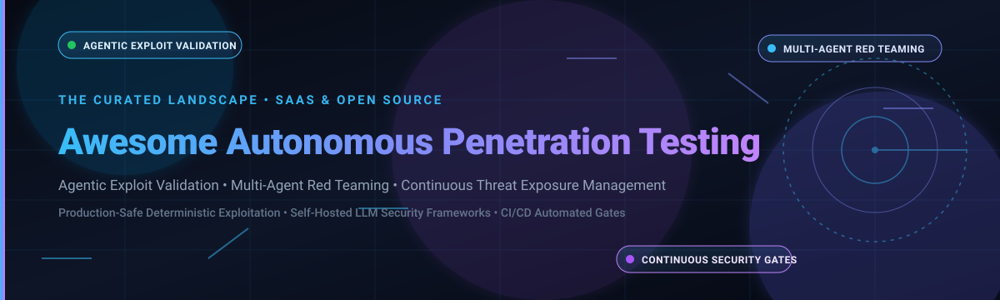

# Awesome-Autonomous-Penetration-Testing 🛡️🤖

  

  
  
  
  
  
  
  

---

## 🎯 Sector Overview & Market Dynamics

The global market for **Autonomous Penetration Testing**, **Continuous Threat Exposure Management (CTEM)**, and **Breach and Attack Simulation (BAS)** is experiencing hyper-growth, expanding from an estimated **$2.5B–$3.2B in 2025** toward **$4.0B+ by 2027** at an aggressive CAGR exceeding **25%–35%** in automated AI validation segments. The sector remains **moderately fragmented**: high-valuation leaders (such as Horizon3.ai and Pentera) anchor enterprise attack emulation, while an influx of specialized autonomous agent startups, MCP-driven tooling, and community-driven open-source projects continuously challenge traditional penetration testing models.

---

## 📑 Table of Contents
- [✨ Key Highlights & Focus Areas](#-key-highlights--focus-areas)
- [🏢 SaaS & Hosted Enterprise Platforms](#-saas--hosted-enterprise-platforms)
- [💻 Open-Source GitHub Projects](#-open-source-github-projects)
- [🏗️ Framework Combinations for Custom Systems](#️-framework-combinations-for-custom-systems)
- [🤝 How to Contribute](#-how-to-contribute)
- [💖 Support](#-support)
- [📈 Star History](#-star-history)
- [⚠️ Disclaimer](#️-disclaimer)

---

## ✨ Key Highlights & Focus Areas

This repository curates notable **SaaS platforms** and **open-source projects** in the **Autonomous Penetration Testing** domain. These tools empower security engineers, CISOs, red teams, and DevSecOps practitioners to run continuous, agentic security assessments that don't just flag hypothetical vulnerabilities—they exploit attack paths, generate concrete proof-of-concept (PoC) validations, and accelerate remediation workflows.

- 🤖 **Agentic Exploit Validation**: Autonomous agents that dynamically reason through multi-step vulnerabilities rather than static signature matching.
- ⚔️ **Multi-Agent Red Teaming**: Orchestrated swarms separating intelligence gathering, exploit staging, execution, and executive reporting.
- 🚪 **CI/CD Security Quality Gates**: Automated offensive verification embedded directly into continuous deployment pipelines.
- 🛡️ **Continuous Threat Exposure Management (CTEM)**: Mapping exploitable paths across web applications, cloud environments, and Active Directory domains.

---

## 🏢 SaaS & Hosted Enterprise Platforms

*Sorted in descending order by company scale (Valuation / Estimated Revenue).*

| Platform | Scale (Valuation / Revenue) 📊 | Category / Focus 🎯 | Key Capabilities & Highlights 🚀 | Pricing / Starting Tier 💳 | Free Tier / Trial Limits ⏳ |
| :--- | :--- | :--- | :--- | :--- | :--- |
| **[Horizon3.ai NodeZero](https://horizon3.ai/)** | **$2B+ Valuation** (Series E, $100M ARR) | Autonomous Penetration Testing | Production-safe autonomous pentests chaining vulnerabilities across web apps, infrastructure, cloud, data, and identity with deterministic attack validation and AI summarization. Trusted by 6,500+ orgs. | Starting tier from **$25,000/year** (scales with asset count and internal/external target scopes) | **14-day free trial**; 1 scoped assessment run with up to 50 active IP endpoints (no permanent free plan) |
| **[Pentera](https://pentera.io/)** | **$1B Unicorn** ($115M–$120M ARR) | Automated Security Validation | Continuous exposure validation combining deterministic attack emulation with agentic adaptability across internal networks, external surfaces, and cloud identity. | Starting tier from **$75,000/year** (scoped by active IP nodes, AD users, and branch scopes) | **No permanent free tier**; 14-day guided proof-of-concept (PoC) scan on single designated network segment |
| **[XM Cyber](https://xmcyber.com/)** | **$700M Acquisition** (by Schwarz Group) | Continuous Exposure Management | Attack path management mapping relationships between identities, misconfigurations, and vulnerabilities to critical enterprise assets. | Starting tier from **$40,000/year** (calculated on total asset count across cloud and on-prem) | **No permanent free tier**; 14-day guided enterprise environment demonstration PoC |
| **[Cymulate](https://cymulate.com/)** | **~$500M Valuation** ($141M Total Funding) | Breach & Attack Simulation (BAS) | Continuous BAS and exposure management with modular attack vectors (email, web gateway, endpoint, WAF, lateral movement). | Starting tier from **$30,000/year** (per module packaging; full suite bundles from $60,000+/year) | **14-day free trial** with access to Email Gateway & Endpoint simulation modules (up to 2 test agents) |
| **[SafeBreach](https://www.safebreach.com/)** | **$106M Funding** (Series D) | Breach & Attack Simulation (BAS) | Continuous security control validation with 20,000+ attack playbooks aligned with MITRE ATT&CK. | Starting tier from **$40,000/year** (scaled by deployed simulator test nodes across segments) | **No permanent free tier**; interactive on-demand sandbox demo & 2-week enterprise PoC |
| **[AttackIQ](https://www.attackiq.com/)** | **~$95M Funding** (Series C) | Breach & Attack Simulation (BAS) | Enterprise BAS control validation platform mapped to MITRE ATT&CK and MITRE D3FEND. | Starting tier from **$50,000/year** (base platform license plus endpoint deployment tiers) | **Free tier via AttackIQ Academy** (educational testing labs); live platform offers 14-day guided lab trial |
| **[Picus Security](https://www.picussecurity.com/)** | **$84M Funding** (Series C) | Security Control Validation | Automated attack simulation and threat exposure management with mitigation validation. | Starting tier from **$35,000/year** (based on integrated security controls and test agents) | **14-day free trial**; access up to 10 simulated threat attack campaigns |
| **[BreachLock](https://www.breachlock.com/)** | **$17M–$25M ARR** ($3.1M Seed) | Pentest-as-a-Service (PTaaS) | Hybrid model combining continuous AI-augmented automated scanning with certified human penetration testing. | Starting tier from **$15,000/year** (covers annual web app/network pentest + automated scans) | **Free forever plan**: External Attack Surface Scanner limited to 1 domain / 5 IP assets; PTaaS features require paid tier |
| **[Vonahi Security (vPenTest)](https://vonahi.com/)** | **Acquired by Kaseya** ($15M+ ARR Est.) | Automated Network Penetration Testing | Automated internal and external network penetration testing built for enterprises and MSPs/MSSPs. | Starting tier from **$15,000/year** (or per-assessment credit packages starting at $2,500/test) | **Single-assessment free trial** (up to 1 internal subnet / 25 IP addresses for qualified organizations) |
| **[RidgeBot](https://ridgebot.com/)** | **$3.1M Funding** (Early Stage) | Autonomous Penetration Testing | AI-driven autonomous vulnerability discovery and exploit simulation across web, network, and cloud targets. | Starting tier from **$20,000/year** (based on concurrent target scanning licenses and IP scopes) | **No permanent free tier**; 14-day evaluation license restricted to 1 target class C subnet (/24) |

---

## 💻 Open-Source GitHub Projects

*Sorted in descending order by GitHub Stars_Count.*

- **[Strix](https://github.com/usestrix/strix)**   
  ⚡ **The leading open-source AI-native pentest framework** (Apache-2.0). Runs autonomous AI agents that act like real attackers—dynamically exploring target applications, probing for vulnerabilities across the OWASP Top 10, and **validating findings with working proof-of-concept exploits**. Multi-agent architecture separates tasks into reconnaissance, exploitation, and reporting, chaining individual flaws into multi-stage attack paths. Docker-based with easy self-hosting.

- **[Metasploit Framework](https://github.com/rapid7/metasploit-framework)**   
  🎯 **Industry-standard exploitation framework** (BSD-3-Clause). The canonical offensive engine used worldwide by red teams and autonomous pentesting agents alike for reliable, modular payload delivery and vulnerability validation.

- **[Nuclei](https://github.com/projectdiscovery/nuclei)**   
  🔍 **Fast and customizable vulnerability scanner** (MIT). Driven by community-maintained YAML templates for automated vulnerability detection, protocol-level probing, and AI-assisted template generation across web applications and infrastructure.

- **[PentAGI](https://github.com/vxcontrol/pentagi)**   
  🧠 **Autonomous AI penetration testing system** (MIT). Organizes work into hierarchical flows, tasks, and actions coordinated by an Orchestrator agent across Researcher, Developer, and sandboxed Kali Linux Executor agents. Includes pgvector semantic memory, optional Neo4j Graphiti knowledge graph, and broad LLM backend support.

- **[Promptfoo](https://github.com/promptfoo/promptfoo)**   
  🛡️ **Open-source automated AI red teaming & LLM security validation** (MIT). Automates adversarial penetration testing, prompt injection, and security fuzzing against LLMs, AI agents, and RAG architectures in CI/CD pipelines.

- **[PentestGPT](https://github.com/GreyDGL/PentestGPT)**   
  🤖 **LLM-driven automated penetration testing framework** (MIT). Operates using an interactive task tree mechanism (parsing, reasoning, and generation modules) to guide and execute end-to-end cyber assessments.

- **[HexStrike AI](https://github.com/0x4m4/hexstrike-ai)**   
  ⚔️ **Autonomous offensive cybersecurity orchestration framework via MCP** (GPL-3.0). Bridges AI models with 150+ security tools (Nmap, Metasploit, Nuclei, Gobuster, SQLmap) to conduct automated reconnaissance, vulnerability scanning, and exploit discovery.

- **[CAI (Cybersecurity AI)](https://github.com/aliasrobotics/cai)**   
  🤖 **AI agent framework for offensive and defensive security** (Apache-2.0). Features native multi-model support (OpenAI, Anthropic, DeepSeek, Ollama) and pre-configured agents for automated reconnaissance, vulnerability analysis, and privilege escalation.

- **[Faraday](https://github.com/infobyte/faraday)**   
  📊 **Open-source collaborative penetration testing and vulnerability management platform** (GPL-3.0). Ingests and normalizes outputs from 80+ tools into an integrated attack graph and real-time dashboard.

- **[T3MP3ST](https://github.com/elder-plinius/T3MP3ST)**   
  🌪️ **Autonomous red teaming platform and multi-agent offensive security meta-harness**. Coordinates autonomous security probing and adversarial exploitation pipelines across targets.

- **[VulnClaw](https://github.com/Netw0rkNoob/VulnClaw)**   
  🐾 **AI-driven penetration testing CLI tool** (Apache-2.0). Provides round-based automated pentesting (information gathering → vulnerability discovery → exploitation → report generation) with MCP toolchain integrations and anti-hallucination validation gates.

- **[Cairn](https://github.com/oritera/Cairn)**   
  🗺️ **AI state-space search engine designed for autonomous penetration testing**. Formulates penetration testing as a state-space traversal problem to systematically discover, evaluate, and navigate attack vectors to target objectives.

- **[RedAmon](https://github.com/samugit83/redamon)**   
  🔴 **Self-hosted AI penetration testing framework** (Apache-2.0). Maps attack surfaces into graphs, autonomously exploits them from sandboxed Kali containers with human approval gates, and generates pull requests to remediate identified flaws.

- **[Pentest-Swarm-AI](https://github.com/Armur-Ai/Pentest-Swarm-AI)**   
  🐝 **Multi-agent autonomous penetration testing swarm** (Apache-2.0). Built with Go, coordinating recon, classification, exploitation, and reporting specialist agents with ReAct reasoning across bug bounty and continuous monitoring targets.

- **[Xalgorix](https://github.com/xalgorix/xalgorix)**   
  🤖 **Autonomous AI pentesting agents** (Go + TypeScript). Delivers real-time target reconnaissance, vulnerability assessment, and exploit orchestration in automated workflows.

- **[Nebula](https://github.com/berylliumsec/nebula)**   
  💻 **AI-assisted penetration testing terminal co-pilot** (GPL-3.0). Integrates directly with shell sessions, offering real-time command suggestions, automated CWE/NIST note-taking, and evidence logging.

- **[Pentest-Agents](https://github.com/H-mmer/pentest-agents)**   
  🧰 **Offensive agent framework and exploit-chain builder**. Features 48 specialized agents, 26 automation commands, and MCP servers compatible with Claude Code, Cursor, and terminal agents.

- **[APTS](https://github.com/OWASP/APTS)**   
  📋 **OWASP Autonomous Penetration Testing Standard**. Community-driven standardization framework specifying architectures, safety bounds, evaluation criteria, and methodologies for autonomous pentesting agents.

- **[HackSynth](https://github.com/aielte-research/HackSynth)**   
  🔬 **LLM agent and evaluation benchmark framework for autonomous penetration testing**. Evaluates LLM reasoning and real-world attack trajectory success across captured flags and enterprise scenarios.

- **[VulnBot](https://github.com/KHenryAegis/VulnBot)**   
  🤝 **Multi-agent collaborative framework for autonomous penetration testing**. Employs cooperative multi-agent task planning and execution strategies for systematic vulnerability discovery and validation.

- **[Autonomous Pentest Agent](https://github.com/kutukam/autonomous-pentest-agent)**   
  🚀 **Full-stack autonomous pentesting system** (AGPL-3.0). Combines a Go backend orchestrator with an intuitive Next.js web dashboard to run end-to-end automated security assessments.

- **[PentestAgent](https://github.com/nbshenxm/pentest-agent)**   
  🎓 **Academic LLM-driven penetration testing framework** (ACM published). Uses a three-agent modular architecture (Reconnaissance, Planning, Execution) with quantitative CVE scoring models for automated exploitation in Kali Linux environments.

- **[pentest-agent (isaacs-12)](https://github.com/isaacs-12/pentest-agent)**   
  🛠️ **Agentic penetration testing with 67+ offensive security skills**. Comprehensive skill registry spanning injection attacks, authentication bypasses, race conditions, request smuggling, and network discovery.

- ⚙️ Community **n8n** workflows for pentest automation and finding triage.

---

## 🏗️ Framework Combinations for Custom Systems

To construct a robust, production-grade, self-hosted autonomous offensive testing pipeline, consider combining these modular open-source layers:
- **Exploit Proving & Dynamic Validation**: **Strix** for proof-of-concept creation and deterministic reproduction.
- **Multi-Agent Orchestration & Tool Execution**: **PentAGI** or **HexStrike AI** (via MCP) for coordinating Kali tools in sandboxed environments.
- **AI Model & Guardrail Testing**: **Promptfoo** for regression testing and CI/CD security quality gates.
- **Unified Finding Triage & Collaboration**: **Faraday** for attack graph aggregation and deduplication.
- **Safety & Architectural Compliance**: **OWASP APTS** for alignment with standardized autonomous penetration testing protocols.

---

## 🤝 How to Contribute

Contributions are warmly welcomed! Help keep this ecosystem guide updated and comprehensive:

1. 🍴 Fork the repository.
2. 📝 Add or edit entries in `README.md` following the established table / list format.
3. 🔗 Include official repository or website links, licensing, and factual descriptions.
4. 🚀 Submit a Pull Request with a clear summary of your additions.

---

## 💖 Support

If you find this curated list valuable for your research, security engineering, or red-teaming work:
- ⭐ **Star this repository** to support discoverability!
- 🍴 **Fork and share** with colleagues, DevOps teams, and security researchers.
- ☕ **Buy me a coffee**: Support ongoing curation and maintenance via the [GitHub Sponsors Dashboard](https://github.com/sponsors/ishandutta2007).

---

## 📈 Star History

---

## ⚠️ Disclaimer

- 🛡️ **Authorized Testing Only**: Autonomous penetration testing and offensive security tooling must only be executed against systems you own or have explicit written authorization to assess. Unauthorized testing violates the Computer Fraud and Abuse Act (CFAA), the UK Computer Misuse Act, and related laws worldwide.
- 🎯 **Reliability & Scope Ceilings**: Current AI agents can surface critical findings but may miss fundamental configuration flaws (such as exposed default credentials) and can produce non-deterministic results across runs. Always pair autonomous validation with experienced human review.
- 🔒 **Data Sovereignty**: Assess the privacy and confidentiality implications of sending internal vulnerability descriptions or endpoint data to third-party LLM providers.
